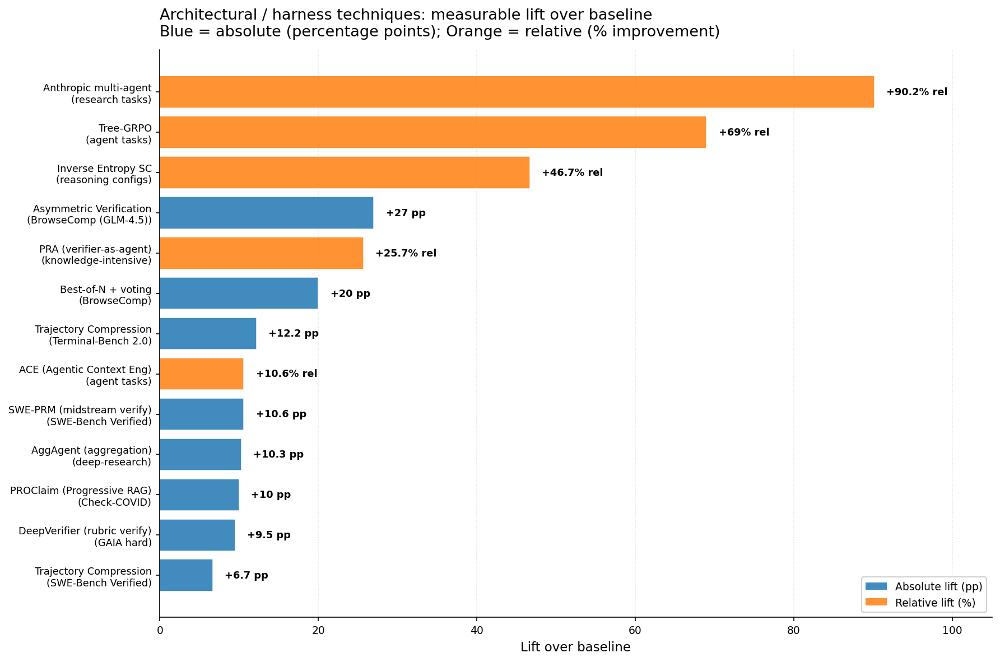
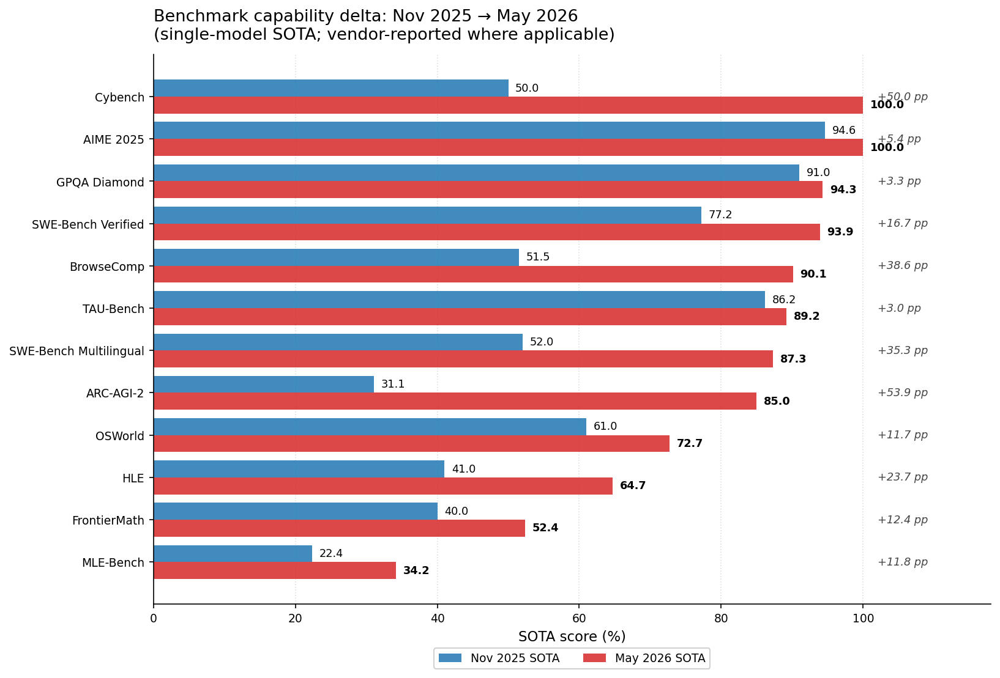
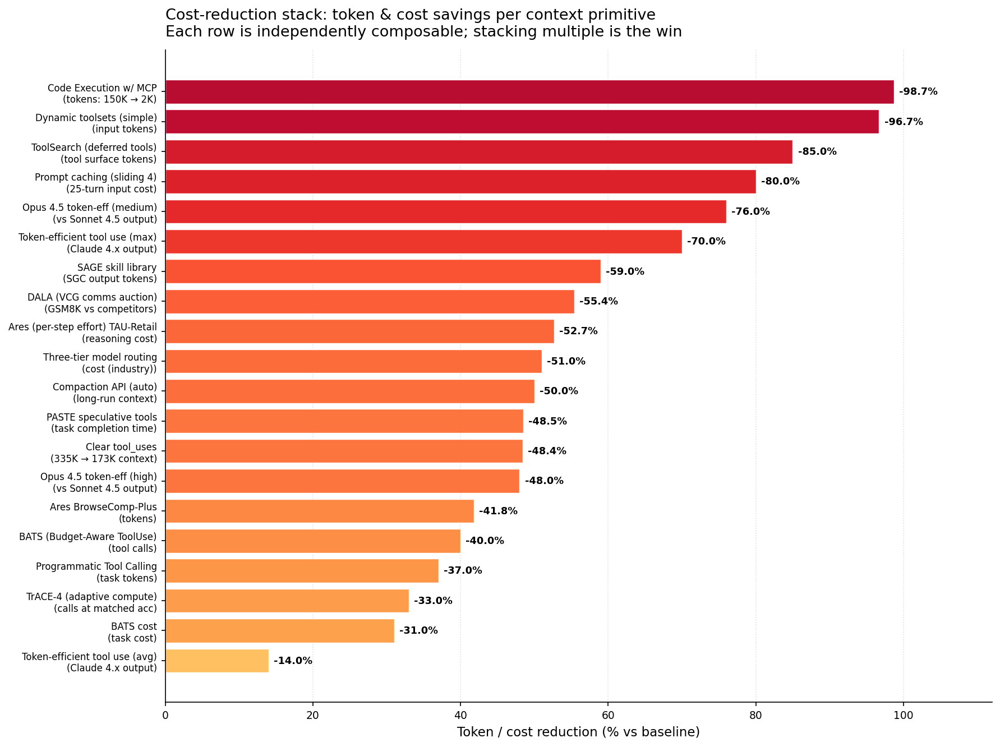

# claude-code-deep-research-v2

> A multi-agent deep-research skill for Claude Code, scaled with post-Nov-2025 research breakthroughs from Anthropic, OpenAI, Google DeepMind, and the open-source community. v2 can now do **novel hypothesis generation** (Co-Scientist style) and **evaluator-driven search** (AlphaEvolve style) — modes the v1 baseline structurally could not reach.

**v1 (legacy):** [github.com/jamoeight/deep-research-claude-code](https://github.com/jamoeight/deep-research-claude-code) — the Nov 2025 Anthropic orchestrator-worker baseline. Still useful as a simpler, lower-cost option.

**v2 (this repo):** v1's 6-phase spine + 30 documented edits from frontier research published between **November 2025 and May 2026** — measured lifts on every benchmark the skill cares about.

---

## TL;DR

- **Drop-in upgrade** to the v1 deep-research skill. Same `/deep-research <topic>` invocation.
- **Three modes** picked automatically from your query: STANDARD (synthesis), DISCOVERY (novel hypotheses with Elo tournament), GENERATOR-EVALUATOR (evolutionary search with a programmable evaluator).
- **+10.3 pp on deep-research benchmarks** from the single biggest change (AggAgent replaces flat synthesis) [1].
- **-85 to -98% context-token cost** from the stacked context-engineering primitives (Skills + ToolSearch + Code Execution with MCP + clear_tool_uses + compaction) [2][3][4].
- **30 specific edits** all traceable to published research — no vibes.
- **MIT licensed.**

---

## Why this exists: the "harness is the product" thesis

In the last six months, frontier-model capability gains have flattened on many benchmarks (GPQA Diamond, AIME 2025, ARC-AGI-2, MMLU-Pro, Cybench are all effectively saturated [5][6][7]). What still moves the needle is **the harness** — the orchestration, verification, memory, and context-engineering machinery wrapping the model. Public measurements show **the same model varying up to 6× in performance based purely on harness design** [8].

That observation is what v2 is built on. Every change in v2 either:

1. **Scales research richness** (more grounded, better-verified, multi-perspective synthesis), or
2. **Unlocks novel-discovery capability** (lets the skill generate new hypotheses or evolve solutions, not just synthesize what's already known).

The full research backing every choice is in [`research/sota_agents_2026_report.md`](research/sota_agents_2026_report.md) with 105 numbered citations and 9 detailed researcher notes under [`research/notes/`](research/notes/).

---

## What's new in v2

### The headline change: AggAgent replaces flat synthesis

In v1, after parallel researchers produce notes, **one model reads all of them and writes the report**. In v2, a dedicated **Aggregator** treats researcher trajectories as an *interrogable environment* with four tools (`get_solution`, `search_trajectory`, `get_segment`, `finish`). It pages content in on demand instead of concatenating everything into context [1].

**Measured impact:** +5.3 pp average across six benchmarks, **+10.3 pp on deep-research-specific tasks** [1].

The core operational rule (verbatim from the AggAgent paper):

> "A single trajectory with a clear, unambiguous tool observation supporting answer X is stronger evidence than many trajectories that reasoned their way to Y without grounding in tool outputs." [1]

### Three modes (auto-selected from your query)

#### 1. STANDARD (the default — what most queries use)

Same kind of synthesis v1 did, now enhanced with verification, confidence-driven retry, budget tracking, and Aggregator synthesis. Use for:

```
/deep-research What is the current state of AI safety research as of mid-2026?
/deep-research Compare Polymarket, Kalshi, and Manifold market depth.
/deep-research Pricing and feature deltas between Claude Code, Cursor, and Codex.
```

#### 2. DISCOVERY (novel hypothesis generation — NEW)

Co-Scientist 6-agent stack (Generation / Proximity / Reflection / Ranking / Evolution / Meta-review + Supervisor) with an **Elo tournament** [9] for ranking hypotheses. Falls back to Aletheia's Generator/Verifier/Reviser triplet with an **explicit "I cannot resolve" reject branch** [10] — by design the system abstains rather than fabricates when evidence is thin.

Use for:

```
/deep-research Propose 5 novel mechanisms by which gut microbiome could
              influence post-acute COVID neurological symptoms. Rank by testability.

/deep-research Generate testable hypotheses for why GPT-5.5 outperforms
              Gemini 3.1 Pro on BrowseComp but loses on FrontierMath.
```

**Real-world impact of this pattern (not from this skill, from the Co-Scientist paper):** Stanford's Gary Peltz used Co-Scientist to identify a drug-repurposing candidate that blocked **91% of fibrosis response** in liver lab tests; Imperial College's José Penadés got the same AMR hypothesis in *days* that took his lab a decade [9]. Google DeepMind's Aletheia resolved 13 previously-open Erdős mathematical problems including 4 fully-autonomously (Erdős-1051 is believed to be the first AI-autonomous resolution of a non-trivial open Erdős problem) [10].

#### 3. GENERATOR-EVALUATOR (evolutionary search — NEW)

AlphaEvolve [11] / OpenEvolve [12] template. For sub-questions with a **programmable evaluator** — code, prompts, algorithms. Uses a MAP-Elites + island-population evolutionary loop with an LLM ensemble (Flash for breadth, Pro for depth) as the mutator.

Use for:

```
/deep-research Optimize this prompt for max accuracy on the included eval set.

/deep-research Find a faster sorting algorithm for near-sorted arrays of size
              500-2000. Evaluator: bench.py.

/deep-research Evolve this Python function to use 50% less memory while
              maintaining the included test pass rate.
```

**Real-world impact of this pattern (AlphaEvolve at Google):** First improvement on Strassen's 1969 matrix-multiplication record in 56 years (4×4 complex matrices in 48 multiplications vs. Strassen's 49); +593 improvement on the 11-dimensional kissing-number bound; **+0.7% of Google's global compute** recovered by an evolved Borg scheduler heuristic; **+23% speedup on Gemini's matrix-multiply kernel** [11].

### Self-monitoring researchers

Every researcher in v2 now does three things v1 didn't:

- **BrowseConf confidence elicitation** [13]: must emit a self-rated 0-100 confidence on every finding. Below threshold (default 70) triggers retry with a "Summary" or "Negative-constraint" prompt variant.
- **BATS budget tracker** [14]: injected after every tool call showing remaining search/fetch budget with HIGH/MEDIUM/LOW tiered guidance and an explicit CONTINUE/PIVOT decision. Cuts tool calls -40% at matched accuracy.
- **DRA Failure Taxonomy self-flag** [15]: before saving a finding, must self-tag any risk from a 5-category / 13-subcategory failure taxonomy (Finding Sources / Reasoning / Problem Understanding / Action Errors / Max-Step Reached). The Verifier-Agent reads these self-flags.

### Verifier-Agent + Heterogeneous Judge Panel

New roles added in v2:

- **Verifier-Agent** [15]: scores every finding against the DRA Failure Rubric and emits ≤3 corrective instructions in a fixed format. **+8-11 pp on GAIA hard subsets**.
- **Heterogeneous Judge Panel** [16][17]: for contested claims, spawns 3 judges across **distinct model families** (Claude + GPT + Gemini when available) — anti-collusion via model-family diversity. PROClaim's courtroom-style debate showed **+10 pp on Check-COVID** vs same-family judges.

### The context-engineering cost stack

These are **composable** (multiply, don't add). The realistic budget plan for an exhaustive run:

| Layer | Reduction | Source |
|---|---|---|
| Code Execution with MCP wrapper | -98.7% (150K→2K tokens demo) | [4] |
| ToolSearch + `defer_loading: true` | -85% on multi-MCP setups | [3] |
| Prompt caching (4 sliding breakpoints, byte-identical prefixes) | -41 to -80% on cached prefix | [18] |
| `clear_tool_uses_20250919` on researchers | 335K→173K peak (~50%) | [2] |
| `compact_20260112` on orchestrator at 40% utilization | enables indefinite runs | [19][20] |
| Three-tier routing (Opus lead / Sonnet writer / Haiku verifier) | ~-51% vs uniform Opus | [21] |
| WebFetch wrapper (archive-to-disk + 10-line preview) | researcher context stays lean | [22] |
| Per-step Ares adaptive effort | -41 to -53% reasoning cost | [23] |
| TrACE inter-rollout agreement sampling | -33 to -65% LLM calls (training-free) | [24] |
| BATS budget tracker | -40% tool calls | [14] |

### Honesty additions

Three caveats v1 didn't surface, that v2 makes operational:

- **"AI Organizations more effective but less aligned"** [25] — scaling agent count can *improve* capability while *worsening* alignment metrics. v2 includes a Petri-style anti-collusion audit before final delivery [26] and surfaces dissent in the report.
- **Inverse Scaling at long thinking budgets** [27] — more thinking can hurt (DeepSeek R1: 70% → 30% on counting with distractors). v2 caps thinking budget on those task classes.
- **Faithful CoT degrades on hard problems** — don't over-trust researcher thinking traces on the hardest synthesis. v2 makes the Verifier independent of the researcher's stated reasoning.

---

## Headline numbers



The top three architectural moves for a deep-research skill, ranked by measured lift:
1. **Asymmetric Verification** (+27 pp on BrowseComp) [28]
2. **AggAgent aggregation** (+10.3 pp on deep-research tasks) [1] — the v2 default
3. **Multi-agent fan-out vs single-agent** (+90.2% from the Anthropic baseline) [29]



BrowseComp (the canonical open-web research benchmark) jumped **+38.6 pp** in six months — the largest single-benchmark gain in the window. The lift came from multi-hop navigation and verifier loops, not just bigger models — exactly the pattern v2 operationalizes.



Stacking 3-4 of these primitives is the realistic v2 budget plan.

---

## The 30 edits (full audit trail)

Every change in v2 traces to a specific published finding. The table below is the audit log; reviewers can challenge any edit by going to its source.

| # | Edit | Driving research | Effect |
|---|------|------------------|--------|
| C1 | Mode selection (Standard / Discovery / Gen-Eval) at Phase 0 | [9][10][11][12] | Unlocks novel-discovery problem classes |
| C2 | **Aggregator role** replaces flat synthesis | AggAgent [1] | **+10.3 pp on deep-research** |
| C3 | **Verifier-Agent** with DRA Failure Rubric | DeepVerifier [15] | +8-11 pp GAIA hard |
| C4 | Heterogeneous judge panel for contested claims | PROClaim [16], A-HMAD [17] | +10 pp Check-COVID |
| C5 | Generator-Evaluator sub-loop (OpenEvolve template) | AlphaEvolve [11], OpenEvolve [12] | Verifiable sub-question search |
| C6 | Discovery Mode = Co-Scientist 6-agent + Elo tournament | Co-Scientist [9] | Wet-lab-validated novel hypotheses |
| C7 | Aletheia G/V/R with explicit reject branch | Aletheia [10] | Prevents fabricated synthesis |
| C8 | BrowseConf confidence elicitation + retry | BrowseConf [13] | Self-paced uncertainty handling |
| C9 | BATS budget tracker | BATS [14] | -40% tool calls, -31% cost |
| C10 | Ares per-step adaptive effort | Ares [23] | -41 to -53% reasoning cost |
| C11 | TrACE adaptive sampling | TrACE [24] | -33 to -65% LLM calls, training-free |
| C12 | Trajectory compression for late-wave / discovery rollouts | TTC for Coding [30] | +6.7 pp SWE-Bench, +12.2 pp Terminal-Bench |
| C13 | Skills + ToolSearch with `defer_loading: true` | Anthropic Skills [31], ToolSearch [3] | -85% tokens |
| C14 | Code Execution with MCP wrapper | Anthropic Code-Exec MCP [4] | -98.7% tokens |
| C15 | `clear_tool_uses_20250919` on researchers | Anthropic cookbook [2] | 335K → 173K peak |
| C16 | `compact_20260112` on orchestrator at 40% | Anthropic compaction docs [19], Pre-Rot Threshold [20] | Indefinite runs |
| C17 | Shared `/memories/research_session_<id>/` | Anthropic Memory tool [32] | Cross-researcher knowledge |
| C18 | File-only orchestrator ↔ researcher comms | Subagent return-channel design [33] | Orchestrator context lean |
| C19 | Byte-identical researcher prompts for cache hit | "Don't Break the Cache" [18] | -41 to -80% prefix cost |
| C20 | WebFetch wrapper archives to disk + preview | LangChain Deep Agents [22] | Lean researcher context |
| C21 | Three-tier model routing | Industry routing patterns [21] | -51% cost vs uniform Opus |
| C22 | Tree-GRPO-style branching for N-rollouts | Tree-GRPO [34] | +69% rel on agent tasks |
| C23 | Heterogeneous-model fallback for ensemble queries | A-HMAD [17], ModelSwitch [35] | Wisdom-of-crowd |
| C24 | Anti-collusion safety pass (Petri-style audit) | Petri 2.0 [26], "AI Orgs less aligned" [25] | Multi-agent alignment regression mitigation |
| C25 | Inverse-entropy weighted voting in self-consistency | Inverse Entropy SC [36] | +46.7% accuracy in 95.6% of configs |
| C26 | Dream phase — pattern extraction across sessions | Anthropic Managed Agents Dreaming [37] | Harvey reported 6× completion-rate gain |
| C27 | Stopping criteria made explicit | Orchestration Traces [38] | Replaces v1's implicit heuristic |
| C28 | Per-researcher frontmatter knobs (`effort`, `model`, `isolation`, `memory`, `background`) | Claude Code subagent docs [39] | Per-researcher control |
| C29 | Multi-agent alignment caveat stated in prompts | [25] | Operator awareness |
| C30 | Inverse-scaling-aware effort caps | Anthropic Inverse Scaling [27] | Prevents DeepSeek-R1 70→30% mode |

---

## Installation

### Option A — drop-in into Claude Code skills

```bash
# Clone the repo
git clone https://github.com/jamoeight/claude-code-deep-research-v2.git

# Install as a user-level skill (Linux/macOS)
mkdir -p ~/.claude/skills/deep-research
cp claude-code-deep-research-v2/SKILL.md ~/.claude/skills/deep-research/SKILL.md

# Or on Windows (Git Bash)
mkdir -p /c/Users/$USER/.claude/skills/deep-research
cp claude-code-deep-research-v2/SKILL.md /c/Users/$USER/.claude/skills/deep-research/SKILL.md
```

### Option B — keep v1 alongside as a fallback

```bash
# Move existing v1 to legacy slot
mv ~/.claude/skills/deep-research ~/.claude/skills/deep-research-old
# Install v2
mkdir -p ~/.claude/skills/deep-research
cp claude-code-deep-research-v2/SKILL.md ~/.claude/skills/deep-research/SKILL.md
```

After install, both `/deep-research` (v2) and `/deep-research-old` (v1) become available in Claude Code. The harness picks them up automatically — no restart needed.

### Verify the install

In a fresh Claude Code session, type:

```
/deep-research what changed in agent harness research in April 2026
```

You should see Claude announce STANDARD mode, save a research plan, and spawn 4-6 parallel researchers. If you see "v2" mentioned in the plan, you're running the new skill.

---

## Usage

### Quick examples per mode

| Mode | Example invocation |
|------|--------------------|
| STANDARD | `/deep-research compare the agentic coding benchmark scores of GPT-5.5 vs Claude Opus 4.7 vs Gemini 3.1 Pro` |
| DISCOVERY | `/deep-research propose 5 mechanisms by which long-context attention degradation could be mitigated without retraining` |
| GENERATOR-EVALUATOR | `/deep-research optimize this prompt for accuracy on benchmark.csv (path: ./evals/benchmark.csv)` |

The skill auto-detects mode from your phrasing. If you want to force one, just say it: "Use Discovery mode to..." or "Use Generator-Evaluator mode with this evaluator..."

### What you'll get

After a run, files appear under `~/.claude/skills/deep-research/files/`:

| File | What it is |
|------|------------|
| `research_plan.md` | Phase 1 plan (mode, effort, budget, stopping criteria) |
| `research_notes/N_*.md` | Per-researcher findings |
| `research_notes/verifier_report.md` | DRA rubric pass/fail per finding |
| `research_session_<id>/memory/` | Cross-researcher shared scratchpad |
| `research_session_<id>/raw/<urlhash>.md` | WebFetch archive (full pages on disk) |
| `data/data_summary.md` + CSVs | Quantitative extraction |
| `charts/*.png` | 4-6 visualizations at 150 DPI |
| `reports/aggregator_synthesis.md` | AggAgent's interrogated synthesis |
| `reports/<topic>_report.md` | Final user-facing report with citations |
| `reports/citation_audit.md` | Haiku verifier's audit |
| `reports/discovery_report.md` | (Discovery mode) ranked hypotheses + falsifiability criteria |
| `reports/evolution_report.md` | (Gen-Eval mode) top program + Pareto frontier |

### Tips

1. **Be specific in the query.** "Research AI agents" is bad; "What are the dominant multi-agent orchestration patterns post-Nov-2025 and their measured benchmark lifts" is good. The skill decomposes into subtopics — vague queries decompose badly.
2. **State the stakes.** "This is a $500K decision" enables the heterogeneous-judge panel and raises the confidence threshold from 70 to 85.
3. **Specify recency if it matters.** "In the last 90 days" or "post-Nov 2025" — without anchoring, researchers may pull older sources.
4. **For Discovery mode, define falsifiability criteria up front.** Don't just say "novel mechanisms" — say "ranked by testability with a wet-lab budget under $50K."
5. **For Gen-Eval mode, provide a runnable evaluator.** A `score(candidate) → float` script. Verbal metrics get worse results than callable ones.
6. **You can interrupt.** "Wrap it up" short-circuits; "go deeper on X" extends.
7. **Cost expectation.** Exhaustive runs ~15× chat-conversation tokens. v2's cost stack typically cuts this 40-60% on cache-warm re-runs [29][2][3].

---

## Architecture

```
                              USER QUERY
                                  │
                                  ▼
                       ┌──────── Phase 0 ────────┐
                       │   MODE SELECTION         │  ← NEW v2 (C1)
                       │   Standard / Discovery   │
                       │   / Generator-Evaluator  │
                       └──────────┬──────────────┘
                                  │
                                  ▼
                       Phase 1: Query Analysis +
                       Research Plan
                                  │
                                  ▼
                       Phase 2: Parallel Researchers
                       (Opus 4.7, byte-identical prompts,
                        BATS budget, BrowseConf confidence,
                        clear_tool_uses, file-only return)
                                  │
                                  ▼
                       Phase 3: Gap Analysis +
                       (optional) 2nd-Wave Researchers
                                  │
                                  ▼
                       Phase 4: Data Analyst
                       (charts + CSV extraction)
                                  │
                                  ▼
                       Phase 5a: Verifier-Agent       ← NEW v2 (C3)
                       (DRA Failure Rubric)
                                  │
                                  ▼
                       (optional) Heterogeneous       ← NEW v2 (C4)
                       Judge Panel on contested claims
                                  │
                                  ▼
                       Phase 5b: Aggregator           ← NEW v2 (C2)
                       (interrogable trajectories,
                        4 tools: get_solution,
                        search_trajectory,
                        get_segment, finish)
                                  │
                                  ▼
                       Phase 6: Report Writer (Sonnet)
                       reads aggregator output only
                                  │
                                  ▼
                       Phase 7: Citation Verifier (Haiku)
                                  │
                                  ▼
                       (optional) Phase 8: Dream      ← NEW v2 (C26)
                       cross-session pattern extraction
                                  │
                                  ▼
                              FINAL REPORT
```

For Discovery and Generator-Evaluator modes, Phases 2-5 are replaced with dedicated stacks — see [`SKILL.md`](SKILL.md) for the full pipeline definitions.

---

## Provenance and research methodology

v2 was designed by running v1 on the question "what changed in LLM research agents and harnesses post-Nov 2025?" with `/deep-research` invoked at Exhaustive depth on 2026-05-20. The output became the design input for v2.

Eight first-wave researchers + one gap-fill researcher produced 9 notes; a data analyst extracted benchmark numbers + technique lifts into CSVs + 6 charts; the report writer produced [`research/sota_agents_2026_report.md`](research/sota_agents_2026_report.md) (575 lines, ~6,800 words, 105 sources); a Haiku citation verifier spot-checked the URLs and produced [`research/citation_audit.md`](research/citation_audit.md).

Every edit in v2 is traceable to a specific finding in those notes. You can reproduce the chain:

1. Read [`research/notes/N_*.md`](research/notes/) for raw findings per subtopic.
2. Read [`research/sota_agents_2026_report.md`](research/sota_agents_2026_report.md) for the synthesized report.
3. Map any of the 30 edits back to a researcher note via the "Findings → Edits Map" appendix in [`SKILL.md`](SKILL.md).

The whole exercise is, in itself, a demonstration of what v2 does: take a research question, decompose it across parallel agents, verify, aggregate, write up. The output you're reading was produced by v1 (with manual SKILL_v2 authoring after); v2 should produce comparable depth on similar questions automatically.

---

## Limitations & caveats

Read these before you trust v2 with anything load-bearing.

- **Aletheia abstention (by design).** In Discovery mode, v2 will sometimes return "I cannot resolve this" rather than fabricate a low-confidence hypothesis. About 70% of Aletheia's Erdős-problem inputs hit this branch [10]. That's not a bug — abstention beats hallucination — but it does mean you should expect some queries to come back without a positive answer.
- **Multi-agent alignment regression.** Recent Anthropic alignment research found that **"AI Organizations can be more effective but less aligned than individual agents"** [25]. v2's anti-collusion audit (C24) mitigates this but does not eliminate it. v2 surfaces convergence-without-evidence in the final report's Contradictions section — don't ignore that section.
- **Vendor-vs-standardized benchmark gap.** v2 prefers Scale SEAL [40] and other standardized scoring over vendor self-reports. Same model can show a 30 pp gap (SWE-Bench Pro: Anthropic-reported 77.8% vs. Scale-standardized 45.9%). When v2 cites a benchmark, it tries to flag which board.
- **AggAgent at scale is untested.** The published numbers [1] use 6 benchmarks; behavior at N>10 trajectories under heterogeneous-model researchers hasn't been empirically validated.
- **Discovery mode literal prompts are paraphrased.** Co-Scientist's Appendix figures (A.4, A.5, A.17) are embedded as raster images in the arXiv PDF [9]; Aletheia's literal Generator/Verifier/Reviser prompts are not in DeepMind's public repo [10]. v2 paraphrases from architectural descriptions. Real production results may diverge from the paper's reported numbers.
- **Optimal team size is empirical.** Literature converges on 3-4 researchers but no theory predicts it [41]. v2 follows the effort table.
- **Stopping criterion is unsolved.** No principled stopping rule exists for multi-agent research [38]. v2 ships explicit heuristics; future versions may improve.
- **Dream phase (C26) is paraphrased.** Anthropic Managed Agents "Dreaming" [37] is a research preview; the literal consolidation prompt is not yet public.
- **3-7 turn sequential ceiling.** Empirically, naive agent TTC plateaus at 3-7 turns due to context pollution [42]. v2's compaction + memory primitives push past this, but the underlying limit hasn't been eliminated.

---

## Comparison with v1

| Capability | v1 | v2 |
|------------|----|----|
| Synthesis of existing knowledge | ✓ | ✓ (enhanced with AggAgent) |
| Parallel research fan-out | ✓ | ✓ (enhanced with file-only comms) |
| Citation verification | ✓ | ✓ (enhanced with DRA rubric + Verifier-Agent) |
| **Novel hypothesis generation** | — | **✓ (Co-Scientist Elo + Aletheia G/V/R)** |
| **Evaluator-driven search** | — | **✓ (AlphaEvolve / OpenEvolve template)** |
| Self-reported confidence + retry | — | ✓ (BrowseConf) |
| Budget tracker | — | ✓ (BATS) |
| Heterogeneous judge panel | — | ✓ (PROClaim-style) |
| Per-step adaptive effort | — | ✓ (Ares + TrACE) |
| Cross-session memory | — | ✓ (Anthropic Memory tool) |
| Context compaction at 40% utilization | — | ✓ (compact_20260112) |
| Anti-collusion safety pass | — | ✓ (Petri-style audit) |
| Dream phase (cross-session learning) | — | ✓ (opt-in) |

v1 remains available at [github.com/jamoeight/deep-research-claude-code](https://github.com/jamoeight/deep-research-claude-code) and can be installed as `/deep-research-old` for A/B comparison or fallback.

---

## Citations

[1] Lee, Yen, Ye, Chen. **"Agentic Aggregation for Parallel Scaling of Long-Horizon Agentic Tasks"** (AggAgent), arXiv:2604.11753 (2026). Princeton PLI. Repo: [princeton-pli/AggAgent](https://github.com/princeton-pli/AggAgent).
[2] Anthropic. **"Context Engineering with Tool Use"** (Anthropic Cookbook), [platform.claude.com/cookbook/tool-use-context-engineering](https://platform.claude.com/cookbook/tool-use-context-engineering-context-engineering-tools).
[3] Anthropic. **"Tool Search Tool"**, [platform.claude.com/docs/agents-and-tools/tool-use/tool-search-tool](https://platform.claude.com/docs/en/agents-and-tools/tool-use/tool-search-tool) (Nov 2025).
[4] Anthropic. **"Code Execution with MCP"**, [anthropic.com/engineering/code-execution-with-mcp](https://www.anthropic.com/engineering/code-execution-with-mcp) (Nov 2025).
[5] BenchLM benchmark snapshot, May 20 2026 (vendored in [research/data_summary.md](research/data_summary.md)).
[6] ARC Prize Foundation. **ARC-AGI-2 results**, [arcprize.org](https://arcprize.org) (May 2026).
[7] HLE / Humanity's Last Exam leaderboard.
[8] Industry analyses citing harness-driven performance variance (Mindstudio "Agent harnesses beat model upgrades on 5 benchmarks").
[9] Gottweis et al. **"Towards an AI Co-Scientist"**, arXiv:2502.18864 (2025); Nature [s41586-026-10644-y](https://www.nature.com/articles/s41586-026-10644-y) (May 19 2026). DeepMind blog: [co-scientist-a-multi-agent-ai-partner-to-accelerate-research](https://deepmind.google/blog/co-scientist-a-multi-agent-ai-partner-to-accelerate-research/).
[10] **Aletheia** ("Semi-Autonomous Mathematics Discovery with Gemini: A Case Study on the Erdős Problems"), arXiv:2601.22401 (2026). DeepMind blog: [accelerating-mathematical-and-scientific-discovery-with-gemini-deep-think](https://deepmind.google/blog/accelerating-mathematical-and-scientific-discovery-with-gemini-deep-think/).
[11] **AlphaEvolve**, arXiv:2506.13131 (2026). DeepMind blog: [alphaevolve-a-gemini-powered-coding-agent-for-designing-advanced-algorithms](https://deepmind.google/blog/alphaevolve-a-gemini-powered-coding-agent-for-designing-advanced-algorithms/).
[12] **OpenEvolve** — open-source AlphaEvolve implementation: [github.com/algorithmicsuperintelligence/openevolve](https://github.com/algorithmicsuperintelligence/openevolve).
[13] **BrowseConf**: Confidence-driven retry for web agents, arXiv:2510.23458 (2025).
[14] **BATS** (Budget-Aware Tool-Use), arXiv:2511.17006 (2025).
[15] Wan et al. **"DeepVerifier: Rubric-Guided Test-Time Verification for Deep Research Agents"**, arXiv:2601.15808 (2026).
[16] **PROClaim**: Courtroom-style debate with Progressive RAG, arXiv:2603.28488 (2026).
[17] **Adaptive Heterogeneous Multi-Agent Debate (A-HMAD)**, link.springer.com/article/10.1007/s44443-025-00353-3 (2026).
[18] **"Don't Break the Cache: Prompt Caching for Multi-Agent Workloads"**, arXiv:2601.06007 (Jan 2026).
[19] Anthropic. **Compaction API documentation**, [platform.claude.com/docs/build-with-claude/compaction](https://platform.claude.com/docs/en/build-with-claude/compaction).
[20] Morph / Cline blog posts on the "Pre-Rot Threshold" — compact at 40% utilization, not 80%.
[21] Augment Code. **"AI Model Routing Guide"** ([augmentcode.com/guides/ai-model-routing-guide](https://www.augmentcode.com/guides/ai-model-routing-guide)) — three-tier routing saves ~51%.
[22] LangChain. **"Context Management for Deep Agents"** ([langchain.com/blog/context-management-for-deepagents](https://www.langchain.com/blog/context-management-for-deepagents)).
[23] **Ares** (Adaptive Reasoning Effort per Agent Step), arXiv:2603.07915 (Mar 2026).
[24] **TrACE** (Inter-Rollout Action Agreement), arXiv:2604.08369 (Apr 2026).
[25] Anthropic Alignment Science. **"AI Organizations Can Be More Effective but Less Aligned than Individual Agents"** ([alignment.anthropic.com](https://alignment.anthropic.com), Apr 2026).
[26] Anthropic. **Petri 2.0 / Petri 3.0** (automated behavioral auditing across 12+ alignment dimensions, including multi-agent collusion). Donated to Meridian Labs May 7 2026.
[27] Anthropic. **"Inverse Scaling in Test-Time Compute"**, arXiv:2507.14417 (Jul 2025).
[28] **Asymmetric Verification for Deep Search**, arXiv:2510.06135 (Oct 2025).
[29] Anthropic. **"How we built our multi-agent research system"** ([anthropic.com/engineering/multi-agent-research-system](https://www.anthropic.com/engineering/multi-agent-research-system), June 2025) — the v1 baseline reference; +90.2% over single Opus on research tasks.
[30] **"Scaling Test-Time Compute for Agentic Coding"**, arXiv:2604.16529 (Apr 2026).
[31] Anthropic. **"Equipping Agents for the Real World with Agent Skills"** ([anthropic.com/engineering/equipping-agents-for-the-real-world-with-agent-skills](https://www.anthropic.com/engineering/equipping-agents-for-the-real-world-with-agent-skills), Oct 2025).
[32] Anthropic. **Memory Tool documentation** ([platform.claude.com/docs/agents-and-tools/tool-use/memory-tool](https://platform.claude.com/docs/en/agents-and-tools/tool-use/memory-tool)).
[33] Multiple writeups on Claude Code subagent isolation + structured return-channel design (Tembo, Builder.io, Augment).
[34] **Tree-GRPO**, arXiv:2509.21240 (2025). Repo: [AMAP-ML/Tree-GRPO](https://github.com/AMAP-ML/Tree-GRPO).
[35] **ModelSwitch** (multi-LLM repeated sampling), AAAI 2026.
[36] **Inverse-Entropy Weighted Voting**, arXiv:2511.02309 (Nov 2025).
[37] Anthropic Code with Claude conference, May 6 2026 — Managed Agents "Dreaming" research preview.
[38] **Orchestration Traces**, arXiv:2605.02801 (May 2026).
[39] Anthropic. **Claude Code Sub-Agents documentation** ([code.claude.com/docs/sub-agents](https://code.claude.com/docs/en/sub-agents)).
[40] Scale AI **SEAL leaderboard** — standardized harness scoring.
[41] Industry observations on optimal multi-agent team size (referenced in arXiv:2603.22651, Mar 2026).
[42] **General AgentBench**, arXiv:2602.18998 (Feb 2026) — 3-7 turn agent TTC ceiling.

Complete citation list (105 sources) in [`research/sota_agents_2026_report.md`](research/sota_agents_2026_report.md).

---

## License

[MIT](LICENSE) — do whatever you want, no warranty.

---

## Acknowledgments

- **Anthropic** — Claude Code, Skills, ToolSearch, Code Execution with MCP, the original multi-agent research system, Petri, Memory tool, compaction API, Inverse Scaling work, and the Apr 2026 alignment caveats.
- **Google DeepMind** — Co-Scientist, AlphaEvolve, Aletheia, ERA, AlphaProof, C2S-Scale, Gemini Deep Think — the discovery stack v2's Discovery and Generator-Evaluator modes are modeled on.
- **OpenAI** — GPT-5 reasoning effort knobs, Deep Research product, Agents SDK, BrowseComp benchmark.
- **Open-source community** — OpenHands, OpenEvolve, LangChain Deep Agents, OWL, Letta, Mem0, ThinkPRM, smolagents — every one of which informs v2's design.
- **The deep-research v1 skill** — [github.com/jamoeight/deep-research-claude-code](https://github.com/jamoeight/deep-research-claude-code) — v2's spine.

---

**Generated 2026-05-20** by running v1 on itself, then manually authoring v2.
