# Operation Hidden Earth: field notes (9-10 Nov 2026)

Overnight discovery run in this repo's DISCOVERY mode. Ten research teams joined independent clues into coordinates, and two planet-scale DEM scans (craters, waterfalls) ran alongside. Every lead was checked in Sentinel-2 (10 m) and Copernicus GLO-30, then a skeptic searched for prior publication.

**Nothing here is a confirmed discovery.** These are places where evidence converges and where no prior record was found, or only a partial one. Open `hidden_earth.kml` in Google Earth to load every pin, or use the links below.

Contents: `notes/` (ten team notebooks, skeptic review `W2_skeptic_review.md`), `findings.json`, `hidden_earth.kml`, `index.html` (report page), `figures/`, `tools/` (imagery, crater scan, waterfall scan and knickpoint test), `data/scan` and `data/waterfalls` (scan outputs).

## A. Look here first (new leads from our own analysis)

### A1. Unsurveyed forest massif 20 km east of Mount Mabu (Mozambique)
`-16.3040, 36.5860` ±3 km · NOVEL-SYNTHESIS · confidence 40/100

After Mabu itself, this is the strongest tall-canopy (>20 m) signal in northern Mozambique: about 11 km² on a ridge with about 940 m of relief. It may be the next 'Google Earth forest'.

*What to look for:* A closed, dark-green canopy on the ridge crest that stands out from the miombo and farmland around it. Compare it with Mabu's forest 20 km to the west. Rule out tea or eucalyptus plantations, which grow in neat blocks.

*Skeptic check:* **Not found in the literature**. The Kew/Bayliss/Timberlake satellite-led programme (Mabu, Namuli, Inago, Chiperone, Cucutea, Ribáuè, Mchese) does not list these massifs. The region is actively worked, so treat them as unsurveyed in print, not proven unvisited.

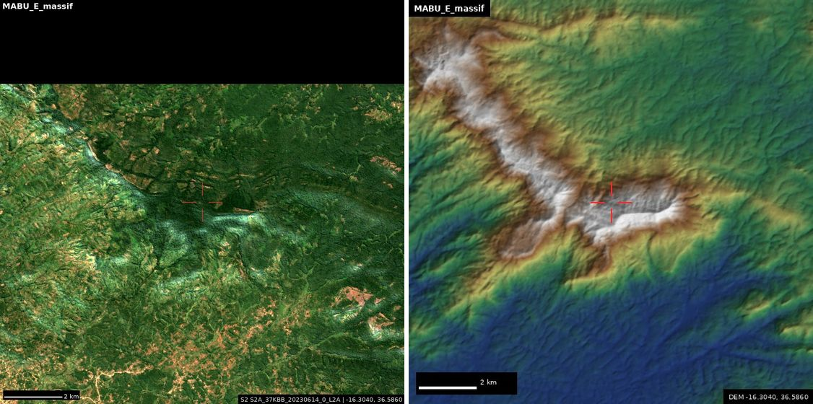

[Google Earth](https://earth.google.com/web/@-16.30400,36.58600,0a,14000d,35y,0h,45t,0r) · [Google Maps](https://www.google.com/maps/@-16.30400,36.58600,12z/data=!3m1!1e3)

### A2. Field of rimmed bowl craters, Amadror/Tefedest (Algeria)
`25.2600, 6.1300` ±20 km · NOVEL-SYNTHESIS · confidence 20/100

The global crater scan found at least 7 rimmed bowls 0.45-1.35 km wide and 30-135 m deep in dark rock. Their clustering points to a volcanic maar or tuff-ring field, not an impact.

*What to look for:* Round craters with raised rims and pale clay floors. Check whether this is a catalogued Hoggar volcanic district. If not, it is an undocumented maar field.

*Skeptic check:* **Not found as a named field**. No catalogued Algerian volcanic field sits here (Atakor, Tahalra, Manzaz, In Teria and In Ezzane are elsewhere). The craters' form matches the In Teria and Oukcem maars, so this is most likely an unmapped maar/tuff-ring group. That is a real geological gap, though not an impact.

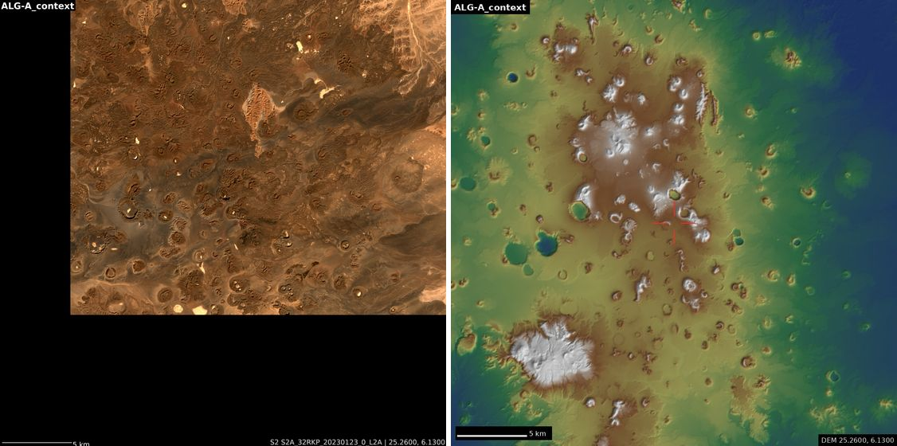

[Google Earth](https://earth.google.com/web/@25.26000,6.13000,0a,40000d,35y,0h,45t,0r) · [Google Maps](https://www.google.com/maps/@25.26000,6.13000,12z/data=!3m1!1e3)

### A3. Giant round doline, Darai Plateau (PNG)
`-6.8594, 143.2436` ±0.5 km · PARTLY-KNOWN · confidence 45/100

A near-perfect closed sinkhole about 1.3 km across and about 260 m deep in the Copernicus DEM, inside the Darai polygonal karst.

*What to look for:* A round, forest-lined pit far larger than the cockpit hollows around it. Tilt the 3D view to see the wall depth. A 30 m DEM under-reads deep pits, so the real depth may be larger.

*Skeptic check:* **Region known; this spot possibly known**. Darai is a classic giant-doline province. A 1993 Centre Terre caving report lists a 'Mégadoline' on the Darai plateau that may be this feature; its coordinates could not be read.

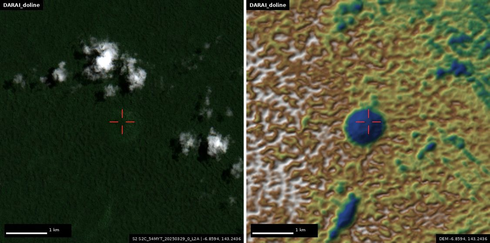

[Google Earth](https://earth.google.com/web/@-6.85940,143.24360,0a,5000d,35y,0h,45t,0r) · [Google Maps](https://www.google.com/maps/@-6.85940,143.24360,15z/data=!3m1!1e3)

### A4. Twin giant closed basins, Lengguru fold belt (West Papua)
`-3.2692, 133.8425` ±0.8 km · PARTLY-KNOWN · confidence 40/100

Two closed karst depressions about 220 m and 255 m deep (sister basin at -3.3492, 133.9714), in a fold belt that cavers have barely visited.

*What to look for:* Forested elongated pits or uvalas with steep walls. The sister basin's floor was a radar void, which often means a very deep shaft.

*Skeptic check:* **Region known; these spots unreported**. IRD/LIPI expeditions (2010-2017) describe Lengguru dolines and poljes in general. Copernicus is a surface model, so forest canopy and radar shadow can exaggerate depth; cross-check in another DEM.

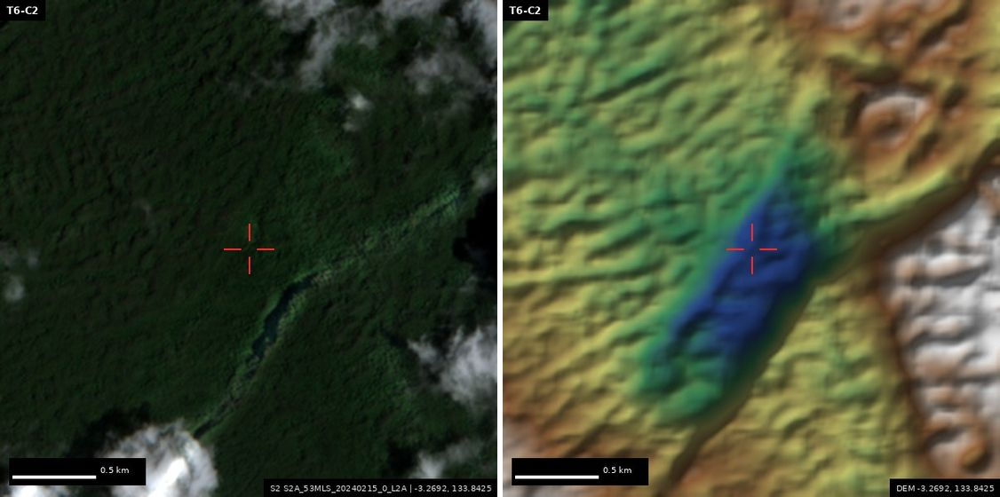

[Google Earth](https://earth.google.com/web/@-3.26920,133.84250,0a,8000d,35y,0h,45t,0r) · [Google Maps](https://www.google.com/maps/@-3.26920,133.84250,15z/data=!3m1!1e3)

### A5. Star Mountains escarpment fall, east of Tabubil (PNG)
`-5.2633, 141.3469` ±0.5 km · NOVEL-SYNTHESIS · confidence 30/100

A 42 km² channel drops about 600 m over about 450 m horizontally, the same DEM shape as Angel Falls. Sentinel-2 shows white water in a slot gorge.

*What to look for:* White water threading down the escarpment slot. On karst it could be a dry hanging valley outside storms.

*Skeptic check:* **Not found as a named fall**. This is the Hindenburg Wall escarpment zone. Check whether the Ok Menga hydro scheme diverts this river.

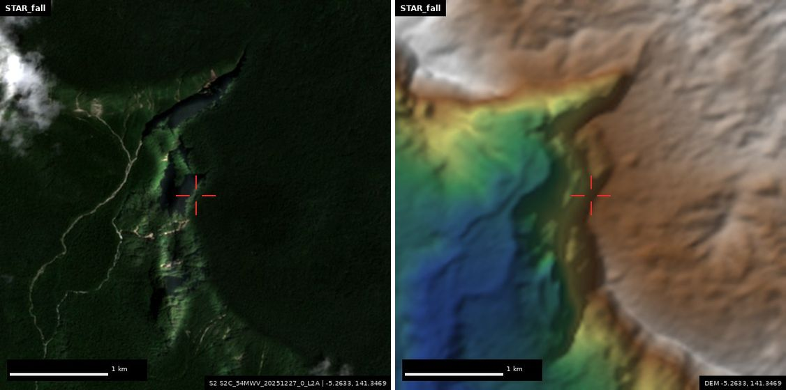

[Google Earth](https://earth.google.com/web/@-5.26330,141.34690,0a,4000d,35y,0h,45t,0r) · [Google Maps](https://www.google.com/maps/@-5.26330,141.34690,15z/data=!3m1!1e3)

### A6. Gorge-head waterfall candidate, Ethiopian highlands
`7.8824, 39.8034` ±0.5 km · NOVEL-SYNTHESIS · confidence 25/100

The DEM knickpoint scan found a river leaving the farmed plateau and dropping at least 170 m into a box canyon. Its catchment is very large (the DEM figure is about 10,600 km²).

*What to look for:* A plunge or cascade at the head of the canyon. Look in the wet season (Jul-Sep): in the dry season it may be a dry lip.

*Skeptic check:* **Not found as a named fall**. Ethiopian escarpments hold hundreds of unnamed seasonal falls, so the novelty value is modest.

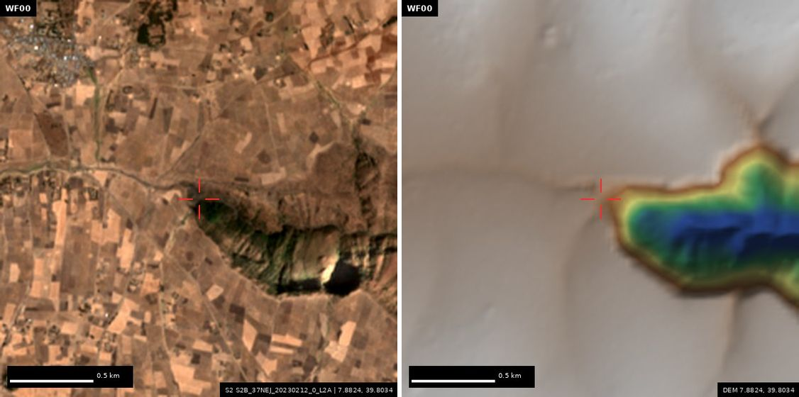

[Google Earth](https://earth.google.com/web/@7.88242,39.80336,0a,4000d,35y,0h,45t,0r) · [Google Maps](https://www.google.com/maps/@7.88242,39.80336,15z/data=!3m1!1e3)

## B. Old mysteries, sharpened

### B1. Akkad (Agade): relict-Tigris / paleo-Adhaim junction
`33.9700, 44.2300` ±8 km · PARTLY-KNOWN · confidence 6/100 · looting-sensitive

Akkad is the only Mesopotamian imperial capital never found. A DEM-traced relict Tigris belt splits from today's river 15 km from where the Adhaim reaches the floodplain, which joins Ziegler's confluence idea to Kawakami's ancient-riverbed idea.

*What to look for:* Tells (low mounds of a few hundred metres) along the dry channel belt between Balad and Ad-Dujayl.

*Skeptic check:* **Variant of published work**. Kawakami (2022, Akkadica 143) already locates Akkade by reconstructing old Tigris courses, and Ziegler favours the Adhaim confluence. This spot, about 20 km NW of Tell Sinker, is a variant of their hypothesis.

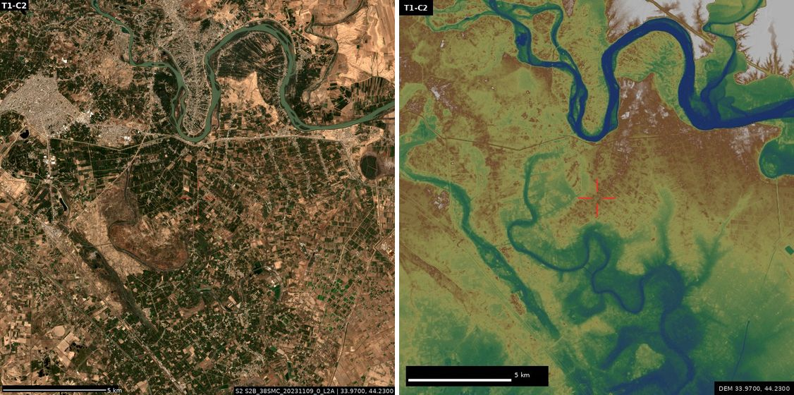

[Google Earth](https://earth.google.com/web/@33.97000,44.23000,0a,25000d,35y,0h,45t,0r) · [Google Maps](https://www.google.com/maps/@33.97000,44.23000,12z/data=!3m1!1e3)

### B2. Tell Sinker, Kawakami's Akkad candidate
`33.7981, 44.3244` ±1 km · PROPOSED · confidence 15/100 · looting-sensitive

An 8.6 m mound sitting on a dry, roughly 50 km cutoff of the Tigris (Balad to Taji).

*What to look for:* A mound rising above the fields.

*Skeptic check:* **Confirmed as Kawakami's candidate**. His project calls it the leading candidate, and a Japan-Iraq survey runs 2024-2027.

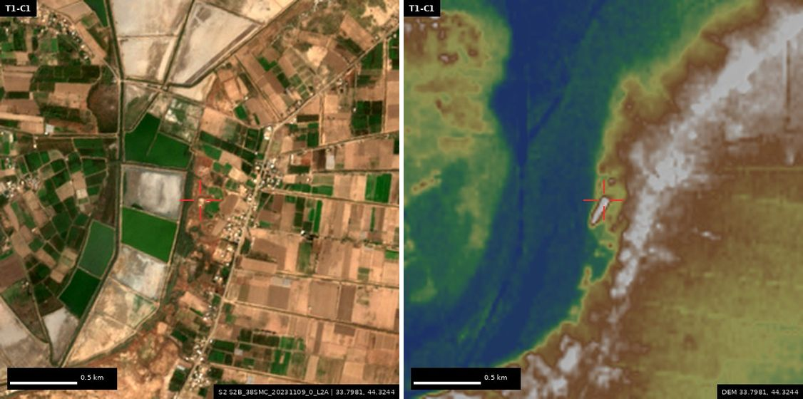

[Google Earth](https://earth.google.com/web/@33.79810,44.32440,0a,4000d,35y,0h,45t,0r) · [Google Maps](https://www.google.com/maps/@33.79810,44.32440,15z/data=!3m1!1e3)

### B3. Chinguetti meteorite: the never-searched midpoint
`20.6800, -11.9400` ±12 km · NOVEL-SYNTHESIS · confidence 3/100

In 1916 Ripert reported a 100 m iron 'hill'. The blacksmiths' account puts a house-sized iron block halfway to Ouadane (about 46 km). The 2024 route paper searched only 12-22 km out. A straight ridge about 60 m high and 20 km long here has never been examined.

*What to look for:* A dark, smooth, isolated mass among the dunes. Check whether the ridge is sand or rock.

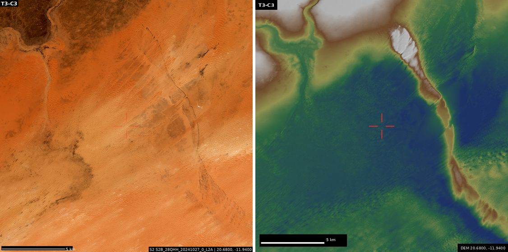

[Google Earth](https://earth.google.com/web/@20.68000,-11.94000,0a,40000d,35y,0h,45t,0r) · [Google Maps](https://www.google.com/maps/@20.68000,-11.94000,12z/data=!3m1!1e3)

### B4. Ho-lao-lo-kia, Xuanzang's sand-buried city
`37.5500, 80.5800` ±30 km · PARTLY-KNOWN · confidence 20/100

Xuanzang places it north of Khotan, with a survivor who fled east to Pi-mo (Uzun-tati), and says it was already a sand mound in 644. That rules out Dandan Oilik, Karadong and Yuansha. The DEM puts the dry downstream end of Pi-mo's streams here.

*What to look for:* Rectilinear walls, dark wood/rammed-earth scatters and old canal lines between dunes.

*Skeptic check:* **Zone known**. Stein searched the desert north of the Chira/Domoko area for this city. No coordinate-level proposal at this point was found; exclude Dandan-Uiliq, Ulugh-Mazar and Karadong first.

[Google Earth](https://earth.google.com/web/@37.55000,80.58000,0a,60000d,35y,0h,45t,0r) · [Google Maps](https://www.google.com/maps/@37.55000,80.58000,12z/data=!3m1!1e3)

### B5. al-Ghaba, the royal town of ancient Ghana
`15.8460, -8.0170` ±7 km · NOVEL-SYNTHESIS · confidence 10/100

al-Bakri (1068) puts the king's town 6 miles from the Muslim town (Koumbi Saleh). That distance meets a low plain with seasonal ponds north-west to north of Koumbi Saleh, and two unexplained 'built-up' land-cover pixels.

*What to look for:* Stone house mounds and enclosure walls on the low plain, especially near 15.8239, -7.9902.

*Skeptic check:* **Not found**. al-Bakri's royal town has never been located, and no targeted search NNW of Koumbi Saleh was found. Check Berthier 1997 first.

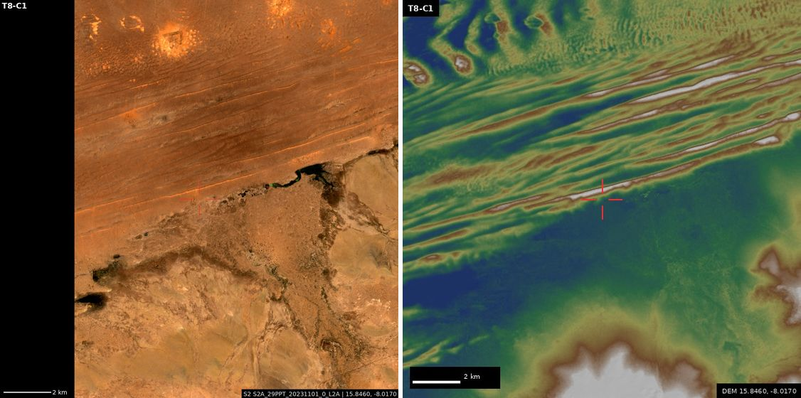

[Google Earth](https://earth.google.com/web/@15.84600,-8.01700,0a,25000d,35y,0h,45t,0r) · [Google Maps](https://www.google.com/maps/@15.84600,-8.01700,12z/data=!3m1!1e3)

### B6. Australasian tektite crater: a falsifiable test of Bolaven
`15.2030, 106.2710` ±10 km · PARTLY-KNOWN · confidence 35/100

This is the source of the largest young strewn field (788 ka), still missing. Two lava flows inside Sieh et al.'s proposed outline are magnetically reversed. If they date to more than 788 ka, Bolaven is falsified; if they date to 773-788 ka, it is strongly supported.

*What to look for:* Nothing visible from orbit: the crater is buried under basalt. This is a fieldwork test.

*Skeptic check:* **Partly done already**. Sieh et al. 2020 reported Ar-Ar dates. No new paleomagnetic or Ar-Ar data from inside the outline since then, so an independent dating test is a real but narrow gap.

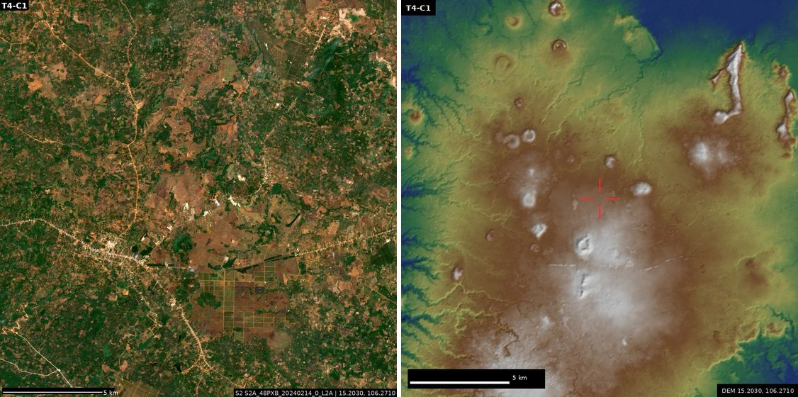

[Google Earth](https://earth.google.com/web/@15.20300,106.27100,0a,40000d,35y,0h,45t,0r) · [Google Maps](https://www.google.com/maps/@15.20300,106.27100,12z/data=!3m1!1e3)

### B7. Njimi, first capital of Kanem = Tié?
`14.1210, 15.7290` ±8 km · PROPOSED · confidence 60/100

DAI/Frobenius identification: a 3.2 ha fired-brick enclosure locally called 'Njimi-ye', dated to the 11th-14th centuries, about 45 km east of Mao.

*What to look for:* A rectangular brick enclosure among the dunes.

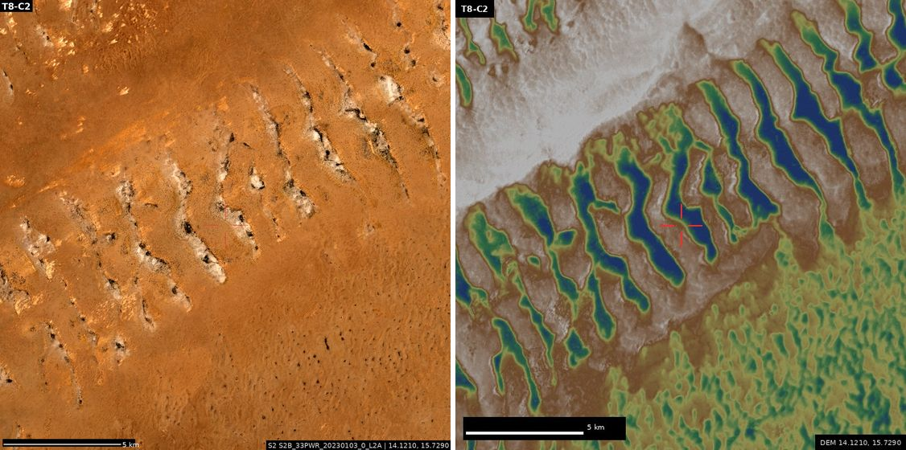

[Google Earth](https://earth.google.com/web/@14.12100,15.72900,0a,20000d,35y,0h,45t,0r) · [Google Maps](https://www.google.com/maps/@14.12100,15.72900,12z/data=!3m1!1e3)

### B8. Lhende Khola 2026 landslide-dam site (Nepal-Tibet)
`28.3340, 85.4840` ±1 km · KNOWN · confidence 90/100

The 2026 barrier lake reported by Chinese state TV and Nepal's NDRRMA/ICIMOD. The team pinned its location independently from Sentinel-2 debris and DEM elevation, which matched the published reports. It drained by late September 2026.

*What to look for:* Fresh debris fan at the junction with the main valley. Compare 2025-10-21 with 2026-10-26.

*Skeptic check:* **Known**. Documented by NDRRMA/ICIMOD and widely reported in August 2026. Kept here as a check that the location method works.

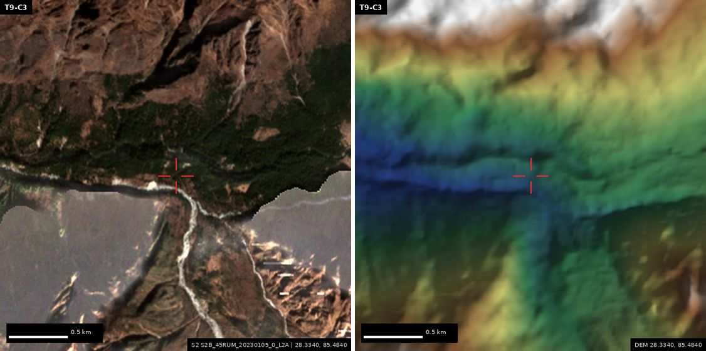

[Google Earth](https://earth.google.com/web/@28.33400,85.48400,0a,6000d,35y,0h,45t,0r) · [Google Maps](https://www.google.com/maps/@28.33400,85.48400,15z/data=!3m1!1e3)

### B9. Tarhuntassa (lost Hittite capital) at Türkmen-Karahöyük
`37.5710, 32.7421` ±5 km · PROPOSED · confidence 25/100

This is the Massa/Osborne candidate (Hartapu inscription). The DEM shows a 30 m mound of the right size. The candidate is contested by the Hulaya-frontier reading, whose alternative is the Karadağ/Kızıldağ zone.

*What to look for:* A large round höyük in the Konya plain.

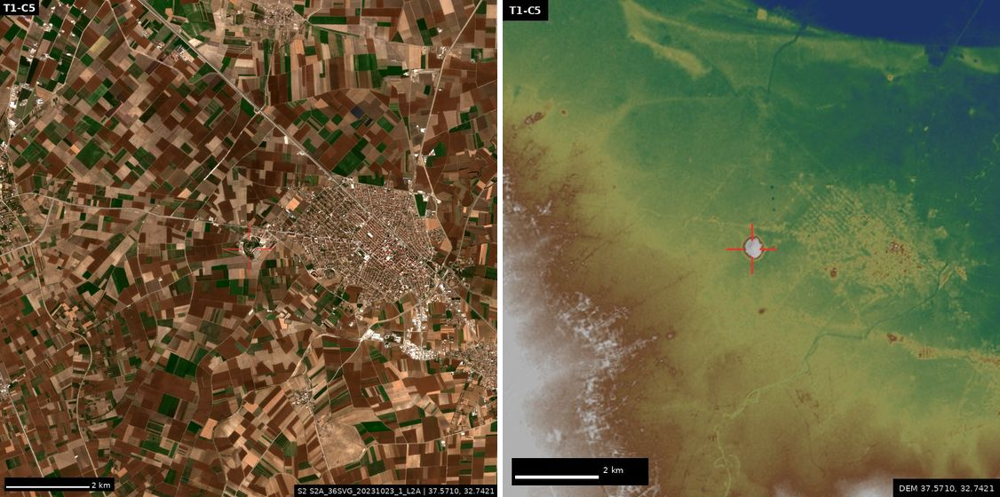

[Google Earth](https://earth.google.com/web/@37.57100,32.74210,0a,8000d,35y,0h,45t,0r) · [Google Maps](https://www.google.com/maps/@37.57100,32.74210,15z/data=!3m1!1e3)

### B10. Itj-tawy, Middle Kingdom capital of Egypt
`29.5720, 31.2360` ±2 km · PROPOSED · confidence 50/100

The town centre lies beneath fields east of the Lisht pyramids. Cores reach a Middle Kingdom layer at 5 m.

*What to look for:* Nothing visible: it is buried under cultivation.

[Google Earth](https://earth.google.com/web/@29.57200,31.23600,0a,8000d,35y,0h,45t,0r) · [Google Maps](https://www.google.com/maps/@29.57200,31.23600,15z/data=!3m1!1e3)

### B11. La Navidad (Columbus, 1492) at En Bas Saline
`19.7250, -72.1250` ±2.5 km · PROPOSED · confidence 55/100

Three diary distances fit together. They also put the Santa María wreck offshore near 19.80, -72.143.

*What to look for:* Reef flats offshore; the site itself needs geophysics.

[Google Earth](https://earth.google.com/web/@19.72500,-72.12500,0a,8000d,35y,0h,45t,0r) · [Google Maps](https://www.google.com/maps/@19.72500,-72.12500,15z/data=!3m1!1e3)

### B12. Fort Caroline (1564), St Johns Bluff vicinity
`30.3840, -81.4970` ±3 km · PROPOSED · confidence 40/100

'South side, six miles from the mouth' measures 10.0 km, which lands on the bluff forest. The Altamaha and St Marys alternatives are untested.

*What to look for:* Bluff-top clearings.

[Google Earth](https://earth.google.com/web/@30.38400,-81.49700,0a,8000d,35y,0h,45t,0r) · [Google Maps](https://www.google.com/maps/@30.38400,-81.49700,15z/data=!3m1!1e3)

### B13. Roanoke Lost Colony: Site X
`36.0030, -76.7100` ±4 km · PROPOSED · confidence 35/100

The fort symbol on the Virginea Pars map patch, plus Border-ware finds on the western Albemarle shore.

*What to look for:* Shoreline fields.

[Google Earth](https://earth.google.com/web/@36.00300,-76.71000,0a,8000d,35y,0h,45t,0r) · [Google Maps](https://www.google.com/maps/@36.00300,-76.71000,15z/data=!3m1!1e3)

## C. Survey-gap boxes to browse at full zoom

- **C1 Amazon geoglyph gap: north of the Abunã**: `-9.2500, -65.4500`. About 700 km² was cleared in 2019-24. There are no catalogued earthworks against Walker et al. 2023, though a known cluster lies just west. [Earth](https://earth.google.com/web/@-9.25000,-65.45000,0a,60000d,35y,0h,45t,0r)
- **C2 Amazon geoglyph gap: Upper Tapajós / Paranaíta**: `-9.4500, -56.9500`. Extends de Souza's 2018 belt of ditched villages. 1,341 km² cleared, none catalogued. [Earth](https://earth.google.com/web/@-9.45000,-56.95000,0a,60000d,35y,0h,45t,0r)
- **C3 Amazon geoglyph gap: Jaci-Paraná / Nova Mamoré**: `-9.8500, -64.9500`. 63% cleared, sitting between two known clusters. [Earth](https://earth.google.com/web/@-9.85000,-64.95000,0a,60000d,35y,0h,45t,0r)
- **C4 Geoglyph plateau across the Peru-Bolivia border (Iñapari)**: `-11.4500, -69.4500`. The Acre geoglyph plateau continues across the border, where survey effort drops. [Earth](https://earth.google.com/web/@-11.45000,-69.45000,0a,60000d,35y,0h,45t,0r)
- **C5 Desert kites: Jebel as-Sawda rim (Libya)**: `28.9000, 15.1500`. A basalt rim adjoining the 330+ known Hamada al-Hamra kites. The Globalkites survey stops at Arabia. [Earth](https://earth.google.com/web/@28.90000,15.15000,0a,40000d,35y,0h,45t,0r)
- **C6 Turgai-type geoglyphs: Ubagan valley (Kazakhstan)**: `51.7000, 64.5000`. 81% unploughed lake-terrace grassland, the same setting as Ushtogay Square, lying between the Turgai core and the Kostanay Tetragon. [Earth](https://earth.google.com/web/@51.70000,64.50000,0a,40000d,35y,0h,45t,0r)
- **C7 Desert kites: Betpak-Dala escarpment (Kazakhstan)**: `45.7000, 67.4500`. An 80 m escarpment like the kite-bearing chinks of the Ustyurt, about 110 km east of the dataset's kite limit. [Earth](https://earth.google.com/web/@45.70000,67.45000,0a,40000d,35y,0h,45t,0r)
- **C8 Mustatils: Hisma basin NW of Tabuk (Saudi Arabia)**: `29.3000, 35.7500`. A corridor between the AlUla/Tayma mustatil core and the southern Jordan rectangles. [Earth](https://earth.google.com/web/@29.30000,35.75000,0a,40000d,35y,0h,45t,0r)
- **C9 Next Yamal gas-blowout crater: search box**: `70.0600, 68.7000`. 4-5 of the roughly 8 known giant craters cluster here near the Bovanenkovo pipeline. Our 2025-26 Sentinel-2 change scan found none new. [Earth](https://earth.google.com/web/@70.06000,68.70000,0a,60000d,35y,0h,45t,0r)
- **C10 New unnamed islands, NE Greenland (Storstrømmen/Zachariae)**: `77.2000, -22.5000`. The island inventory stops at 2020, and Pelto notes islands released by retreating ice since then. [Earth](https://earth.google.com/web/@77.20000,-22.50000,0a,80000d,35y,0h,45t,0r)
- **C11 Ahnet-Tidikelt Holocene megalake basin (Algeria)**: `25.6600, 1.5400`. A DEM-derived highstand lake basin of about 9,000 km². Its inflow deltas are the best targets for Holocene shoreline sites. [Earth](https://earth.google.com/web/@25.66000,1.54000,0a,50000d,35y,0h,45t,0r)

## W. Waterfall-scan shortlist

- **W1 Waterfall candidate (Ethiopia)**: `12.4700, 39.2353`. DEM step of 147 m over 127 m; knickpoint ratio 20.6; catchment about 2322 km²; lip at 1837 m. [Earth](https://earth.google.com/web/@12.47000,39.23525,0a,3500d,35y,0h,45t,0r)
- **W2 Waterfall candidate (NewGuinea)**: `-6.7146, 144.5312`. DEM step of 131 m over 127 m; knickpoint ratio 5.3; catchment about 2742 km²; lip at 840 m. [Earth](https://earth.google.com/web/@-6.71457,144.53119,0a,3500d,35y,0h,45t,0r)
- **W3 Waterfall candidate (NewGuinea)**: `-3.8743, 137.0855`. DEM step of 148 m over 127 m; knickpoint ratio 21.7; catchment about 601 km²; lip at 2455 m. [Earth](https://earth.google.com/web/@-3.87430,137.08547,0a,3500d,35y,0h,45t,0r)
- **W4 Waterfall candidate (Ethiopia)**: `7.6521, 39.9335`. DEM step of 151 m over 127 m; knickpoint ratio 4.6; catchment about 1842 km²; lip at 2292 m. [Earth](https://earth.google.com/web/@7.65206,39.93347,0a,3500d,35y,0h,45t,0r)
- **W5 Waterfall candidate (NewGuinea)**: `-4.4188, 139.1439`. DEM step of 100 m over 90 m; knickpoint ratio 3.6; catchment about 9502 km²; lip at 1473 m. [Earth](https://earth.google.com/web/@-4.41879,139.14393,0a,3500d,35y,0h,45t,0r)
- **W6 Waterfall candidate (NewGuinea)**: `-4.1221, 137.6319`. DEM step of 137 m over 127 m; knickpoint ratio 2.7; catchment about 4166 km²; lip at 2833 m. [Earth](https://earth.google.com/web/@-4.12208,137.63194,0a,3500d,35y,0h,45t,0r)
- **W7 Waterfall candidate (NewGuinea)**: `-4.1295, 137.5221`. DEM step of 113 m over 127 m; knickpoint ratio 2.8; catchment about 7532 km²; lip at 3305 m. [Earth](https://earth.google.com/web/@-4.12948,137.52206,0a,3500d,35y,0h,45t,0r)
- **W8 Waterfall candidate (NewGuinea)**: `-5.8882, 146.0382`. DEM step of 176 m over 127 m; knickpoint ratio 4.0; catchment about 854 km²; lip at 1742 m. [Earth](https://earth.google.com/web/@-5.88819,146.03819,0a,3500d,35y,0h,45t,0r)
- **W9 Waterfall candidate (NewGuinea)**: `-6.1618, 142.9669`. DEM step of 164 m over 127 m; knickpoint ratio 3.9; catchment about 1071 km²; lip at 1166 m. [Earth](https://earth.google.com/web/@-6.16179,142.96694,0a,3500d,35y,0h,45t,0r)
- **W10 Waterfall candidate (Ethiopia)**: `12.6053, 38.7252`. DEM step of 111 m over 127 m; knickpoint ratio 5.4; catchment about 2310 km²; lip at 2043 m. [Earth](https://earth.google.com/web/@12.60533,38.72522,0a,3500d,35y,0h,45t,0r)

## Calibration targets (methods found these blind)

- **K1 Meteor Crater (crater-scan check)**: `35.0275, -111.0225`. Found blind by the DEM crater scan. [Earth](https://earth.google.com/web/@35.02750,-111.02250,0a,3000d,35y,0h,45t,0r)
- **K2 Tenoumer crater (crater-scan check)**: `22.9180, -10.4080`. The only candidate the scan returned in its 1°×1° tile. [Earth](https://earth.google.com/web/@22.91800,-10.40800,0a,4000d,35y,0h,45t,0r)
- **K3 Kaieteur Falls (waterfall-scan check)**: `5.1750, -59.4800`. Found blind by the waterfall scan and passed the knickpoint (discrete-step) test. [Earth](https://earth.google.com/web/@5.17500,-59.48000,0a,4000d,35y,0h,45t,0r)
- **K4 Angel Falls (waterfall-scan check)**: `5.9675, -62.5356`. Top-ranked of 102 candidates in its tile. [Earth](https://earth.google.com/web/@5.96750,-62.53560,0a,4000d,35y,0h,45t,0r)
- **K5 Mount Mabu forest (sky-island check)**: `-16.2900, 36.4000`. The 2005 Google-Earth discovery that A3 is modelled on. [Earth](https://earth.google.com/web/@-16.29000,36.40000,0a,14000d,35y,0h,45t,0r)
- **K6 Ushtogay Square geoglyph**: `50.8329, 65.3263`. Shows what Turgai geoglyphs look like (sub-metre imagery needed). [Earth](https://earth.google.com/web/@50.83290,65.32630,0a,2500d,35y,0h,45t,0r)

## Negative results

- **Crater scan:** 2,887 desert tiles at 60 m. Run blind, it put Tenoumer, Talemzane, Amguid, Wolfe Creek and Meteor Crater at or near the top of their tiles. It found no convincing new impact crater: of the 226 non-volcanic candidates, nearly all are megadune hollows, open-pit mines or maar fields.
- **Resolution limit:** at 10 m, Sentinel-2 does not show known Amazon geoglyphs (Tequinho, Jacó Sá), Turgai geoglyphs or kite walls. Those searches need sub-metre imagery.
- **Badain Jaran:** a re-run microtektite fit argues against it as the Australasian tektite source (never selected in 500 bootstraps).
- **Already known:** the Lhende Khola 2026 landslide lake was already documented (NDRRMA/ICIMOD).

## Limits

Sub-metre imagery hosts, Wikipedia, GBIF and most journals were unreachable from the sandbox, and the web-search budget ran out early. A usage limit also interrupted eight teams. Novelty checks are therefore partial: verify before citing.
## H. Round 2: human-made sites (9-10 Nov 2026)

Three teams worked on lost capitals from texts, missing stations on ancient roads and ruined desert towns. A fourth search, my elevation-model tell finder, found Tell Brak blind among 242 Khabur tells. Every lead was looked at in Sentinel-2 and the DEM. **Coordinates of possibly unrecorded or looting-prone sites are rounded to 0.1° (about 10 km) in this public copy.** Exact positions are only in the owner's private report.

### H1. Oval fortified mound with keep and moat, east of Zaranj (Afghan Sistan)
`30.9, 62.0` ±10 km · NOVEL-SYNTHESIS · confidence 55/100 · looting-sensitive

An 11.5 m oval mound (210 × 135 m) with a 45 m rectangular building on top and a ring about 300 m across around it, like a moat or outer wall. A 70 m square enclosure sits 2.3 km NNW. It has the shape of a Sistan qal'a. (Location rounded to about 10 km in the public copy.)

*What to look for:* Mud-brick walls, a gate gap in the outer ring, and wind-cut erosion ridges around the base. Rule out a natural yardang reused by modern buildings.

### H2. Abandoned grid town around a 12.7 m tell, NE of Pust-i Gau (Afghan Sistan)
`31.3, 62.1` ±10 km · NOVEL-SYNTHESIS · confidence 45/100 · looting-sensitive

A rectilinear grid of compounds covering at least 1 km² around a roughly 200 m mound. Its tone in the short-wave infrared matches the mud-brick walls of Pust-i Gau, 6 km away. (Location rounded to about 10 km in the public copy.)

*What to look for:* Courtyard houses in a grid, streets, a citadel on the mound, canal lines leading in.

### H3. Square walled enclosure (qal'a?) on a rise, Afghan Sistan
`30.9, 62.1` ±10 km · NOVEL-SYNTHESIS · confidence 40/100 · looting-sensitive

A crisp 100 m square with thick walls (black in SWIR) and a 30-40 m ring beside it, on an 8.6 m rise. It is either a caravanserai or fort, or a modern compound or security post. (Location rounded to about 10 km in the public copy.)

*What to look for:* Corner towers and a central courtyard suggest a caravanserai or fort. Vehicles, razor wire or new roofs mean it is modern.

### H4. Rampart-ringed oval mound in abandoned fields, SE of Pust-i Gau
`31.2, 62.1` ±10 km · NOVEL-SYNTHESIS · confidence 40/100 · looting-sensitive

A 420 × 270 m oval with a dark raised rim, 8.7 m high in the DEM, sitting among relict strip fields. (Location rounded to about 10 km in the public copy.)

*What to look for:* A rampart circuit and interior building mounds.

### H5. Walled oval enclosure on a mound, north of Zaranj (Afghan Sistan)
`31.3, 61.9` ±10 km · NOVEL-SYNTHESIS · confidence 30/100 · looting-sensitive

The lead's DEM tell finder flagged a 21 ha, 11 m mound. In Sentinel-2 it shows a bounded oval enclosure about 400 m across. This is an independent hit in the same corridor as H1-H4. (Location rounded to about 10 km in the public copy.)

*What to look for:* An enclosure wall on the mound.

### H6. Opis (Upi), and possibly Akshak, at Tulul al-Mujaili' on a relict Diyala levee
`33.2, 44.7` ±10 km · PROPOSED · confidence 40/100 · looting-sensitive

Opis was a major Tigris-Diyala city of Babylonian and Persian times. The DEM puts the proposed mound on a NNW-SSE relict levee 15 km NE of Ctesiphon, which splits at a distributary node 6.5 km SSW. The channel link is new; the identification is published. (Location rounded to about 10 km in the public copy.)

*What to look for:* A 500 × 200 m low mound and the levee ridge running past it.

### H7. Aratu, a lost Roman road station = the fort at Zawiyet el-Agdab (Egypt)
`31.3906, 25.5039` ±3 km · NOVEL-SYNTHESIS · confidence 35/100

Aratu is on the Tabula Peutingeriana but unlocated in the Barrington Atlas. Its road distances (Catabathmus 28, Nesus 26 Roman miles) put the distance-only point in the sea, so the station must lie inland. The only recorded Roman fort within 9 km of the inland solution fits the distances to within 6%.

*What to look for:* A square Roman fort a few tens of metres across.

### H8. Atil, the Khazar capital, tested at Samosdelka (Volga delta)
`46.024, 47.8398` ±3 km · PROPOSED · confidence 15/100

Raised ground on both banks of a 250-300 m channel, with an island at a fork, matches the Arab 'twin city on both banks' layout. Each bank is far smaller than the accounts imply, though, and a 2020 review rejected the identification.

*What to look for:* Settlement ground on both banks of the Staraya Volga channel.

### H9. Ekallatum zone, 18 km north of Assur: a salvage priority
`35.6, 43.2` ±10 km · PROPOSED · confidence 20/100 · looting-sensitive

Ekallatum was Shamshi-Adad I's royal city. The published '18 km north of Assur, west bank' lands on a terrace-edge town, and no floodplain tell of 4 m or more lies below it. The whole valley is in the Makhul dam reservoir zone, where construction resumed in 2021. (Location rounded to about 10 km in the public copy.)

*What to look for:* A terrace-edge tell under or beside the modern town.

### H10. Merrha of Isidore of Charax = Mari (Tell Hariri)?
`34.6, 40.9` ±10 km · NOVEL-SYNTHESIS · confidence 30/100 · looting-sensitive

Five schoeni below Dura, with the schoenus calibrated on the Dura-Anatho leg, lands 2.6 km from Mari along the river. The name Merrha echoes Mari. (Location rounded to about 10 km in the public copy.)

*What to look for:* Mari's great tell beside the Euphrates.

### H11. Zalpuwa 'on the sea' at İkiztepe (Kızılırmak delta)
`41.6189, 35.8436` ±3 km · PROPOSED · confidence 25/100

An isolated 22 m hill at the inner edge of a delta that held lagoons until about 4,000 years ago, 7.7 km from today's coast. That fits Zalpuwa 'on the sea' in the Old Assyrian era.

*What to look for:* An excavated hill above a flat delta.

### H12. al-Afa'iya water station on the Darb Zubayda pilgrim road (Saudi Arabia)
`23.0, 40.8` ±14 km · PROPOSED · confidence 25/100 · looting-sensitive

The 32/34-mile interpolation between Mahd adh-Dhahab and Faydat al-Mislah falls 1.25 km from a bright 70-90 m square at the edge of a clay pan. It could be a plastered birka (Abbasid reservoir). (Location rounded to about 10 km in the public copy.)

*What to look for:* A square or round stone-lined reservoir with a settling tank. Only 2 of 4 known tanks show at 10 m, so zoom in.

### H13. Round wooded settlement mounds, central Mali
`13.2, -5.5` ±10 km · NOVEL-SYNTHESIS · confidence 20/100 · looting-sensitive

The DEM tell finder found a 55 ha, 6 m round mound with a dark wooded cap beside the river. A second one, 85 ha and 12 m, sits at [location withheld]. Their shape is typical of abandoned Middle Niger towns. Regional registers could not be checked. (Location rounded to about 10 km in the public copy.)

*What to look for:* Pottery-strewn mound surfaces, house-wall rings and erosion gullies.

Round-2 negative results: the Daryalyk/Sarykamysh delta, the Loulan/Kongque area (10 m cannot separate walls from yardangs), the Murghab northern fringe and south Sistan showed nothing convincing. The 'Centum Putea' square near Palmyra is most likely a modern hafir (rainwater pond). Most DEM tell-finder hits in Cholistan, the Inland Niger Delta and Kanem were dunes, natural hills or modern villages on mounds.

## S. Secret cults (lost sanctuaries of mystery religions)

Historical and archaeological cults only; present-day groups are deliberately left out. Coordinates of undocumented archaeological targets are rounded to 0.1°.

- **S1 Lost mithraeum of Whitley Castle (Epiacum), Northumberland**: `54.8, -2.5` · NOVEL-SYNTHESIS · confidence 35/100. Mithraism was a Roman mystery cult that met in small, half-sunken 'cave' temples. A Mithras altar turned up in 1837 about 91 m east of this fort's north-east corner. At Housesteads, Carrawburgh, Rudchester and Segontium the temple sits 145-342 m out, 6-45 m downslope, in a hollow. That pattern points to the falling ground about 200 m east of the fort. (Location rounded to about 10 km in the public copy.)
- **S2 Karnasion grove, sanctuary of the Andanian Mysteries (Messenia)**: `37.3, 21.9` · PROPOSED · confidence 25/100. These were secret initiation rites second only to Eleusis, and their grove has never been located. Pausanias puts it 8 stades (about 1.5 km) from Andania, and the great Mysteries inscription was found 10 minutes' walk from Konstantinoi. Together these favour a spot about 1 km north-west of the published Divari-spring placement. (Location rounded to about 10 km in the public copy.)
- **S3 Oracle of Trophonius, the underground oracle of Lebadeia (Greece)**: `38.4, 22.9` · NOVEL-SYNTHESIS · confidence 15/100. Consulting this oracle meant a terrifying descent into a narrow underground chamber. Its entrance has never been securely identified. Pausanias's order (grove, then oracle, then a further climb to the temple of Zeus Basileus) plus the elevation profile points to the only level shelf on the ascent. A rival published claim puts it at a well beside the summit temple. (Location rounded to about 10 km in the public copy.)
- **S4 Göbekli Tepe look-alike knoll, southern Tektek escarpment (Turkey)**: `37.0, 39.2` · NOVEL-SYNTHESIS · confidence 12/100. The Taş Tepeler enclosures, with their carved T-shaped pillars, are humanity's oldest known cult centres (about 9600-8000 BC). A terrain score built from the known sites ranks Göbekli Tepe itself in the top 1.5% of 2,193 regional knolls. This knoll, 11 km south of Harbetsuvan on the same escarpment as Kurt, Karahan and Harbetsuvan, has the radial profile closest to Göbekli's of the 38 examined. (Location rounded to about 10 km in the public copy.)
- **S5 Plateau summit between the Euphrates sites and the Taş Tepeler group**: `36.9, 38.1` · NOVEL-SYNTHESIS · confidence 10/100. A soil-capped summit on the Birecik-Suruç plateau, in the survey gap between the Euphrates PPNA sites and the western Taş Tepeler cluster. Of the summits examined, its tone pattern is the most like Göbekli's. (Location rounded to about 10 km in the public copy.)
- **S6 Vindolanda's missing mithraeum (Hadrian's Wall)**: `55.0, -2.4` · NOVEL-SYNTHESIS · confidence 10/100. Vindolanda is the best-studied fort on the Wall, yet no Mithras temple has been found there. Pattern scoring picks the stream hollows 150-170 m out and about 10 m below the fort. (Location rounded to about 10 km in the public copy.)
- **SK1 Jonestown, Peoples Temple settlement (Guyana), historical context**: `7.6894, -59.95` · KNOWN · confidence 90/100. This was the site of the 1978 mass murder-suicide. Forest has reclaimed it; only a track shows at 10 m.
- **SK2 Rajneeshpuram / Big Muddy Ranch (Oregon), historical context**: `44.83, -120.487` · KNOWN · confidence 95/100. The 1980s commune of the Rajneesh movement, which was behind the 1984 salmonella attack. It is now a youth camp, and its buildings and reservoir are still clear from orbit.
- **SK3 Colonia Dignidad / Villa Baviera (Chile), historical context**: `-36.3869, -71.5881` · KNOWN · confidence 95/100. Paul Schäfer's sealed German enclave, used as a torture site under Pinochet. It sits clearly visible on the Perquilauquén river.
